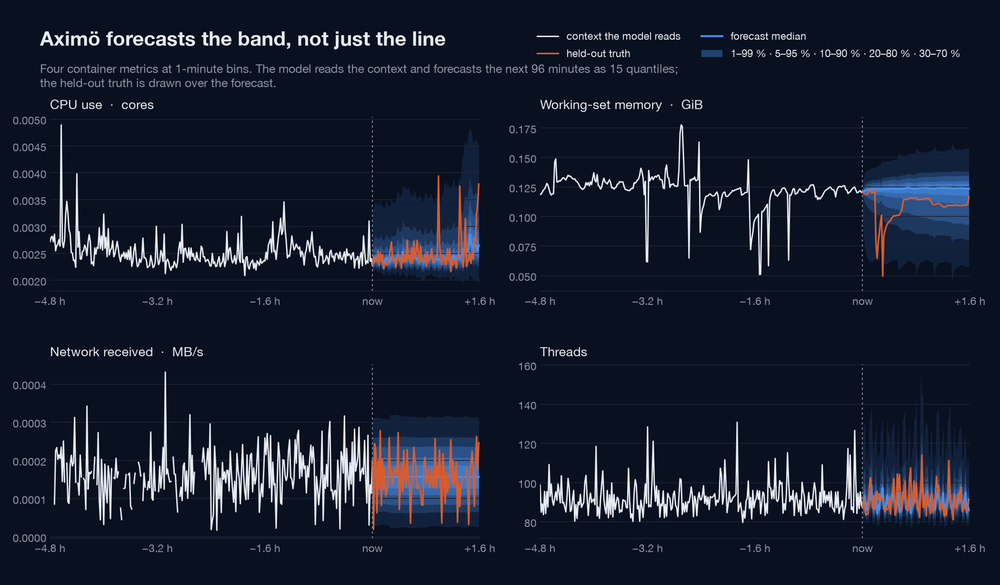
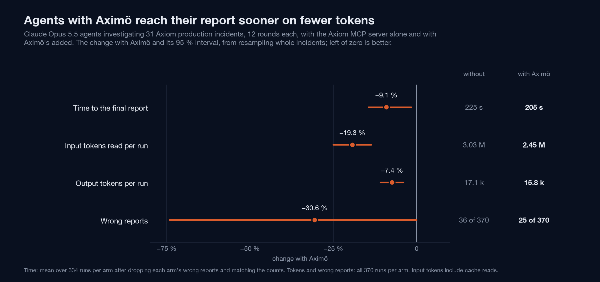

# Aximö

Aximö is a time-series forecasting model, trained by [Axiom](https://axiom.co) on its own
telemetry, for OpenTelemetry and Kubernetes container metrics. For one metric series it reads
the last 2,032 samples and returns the next 16 as a band of 15 quantiles, from the 1st to the
99.9th percentile. A value outside the band is a surprise, and surprises across the containers
of a cluster are what an incident investigation looks for.

Aximö reads one series at a time, and the forecast is enhanced by two tags: which metric the
series is and at which interval it was sampled. These two tags are the centre of the design.
Toto 2.0 and Chronos-2 are given the values alone and can read other series of the same system
beside them; Aximö instead learns from the tags what kind of series it is reading.
[The two tags](#the-two-tags-which-metric-at-which-interval) says what they are and what they do.



This revision is `aximoe-261123`, 4,036,464 parameters. Each published model is a tag of this
repository named `aximoe-YYMMDD`; `main` holds the latest.

## The two tags: which metric, at which interval

Every block of 16 samples is embedded, and two learned vectors are added to it before the
transformer reads it: the row of the series' **channel**, the metric it measures, and the row of
its **resolution**, the seconds per sample.

| table      | rows in `aximoe-261123`                                            | in `model.json` |
|------------|--------------------------------------------------------------------|-----------------|
| channel    | 36 container metrics, plus `unknown`                               | `channels`      |
| resolution | 10 s, 30 s, 1, 2, 5, 10, 15, 20 and 30 min, 1 h, plus `unknown`    | `widths`        |

The channels are the cAdvisor and kube-state-metrics series every Kubernetes cluster exports:
CPU use, throttling and burst; memory working set, RSS, cache and allocation failures; network
and file-system rates; CPU, memory and I/O pressure stall; processes, threads and sockets;
restarts and OOM kills. In training each tag is replaced by its `unknown` row on 10 % of the
tiles, independently of the other, so a series whose metric or interval the model does not know
still runs on a trained row.

**Why a row per metric.** A busy metric shows what it is in every block; a quiet one, zero most
of the time, shows it only at its rare events. With the channel tag, training learns each metric
as what it is: quiet metrics are forecast 3 to 5 % better (the interval score of the 10 to 90 %
band) than without it, at a cost of at most 0.7 % on busy ones, and one row per metric beat every
coarser table tried, from five name families down to a single row for all. These comparisons were
made on earlier models of the same recipe and are recorded in
[docs/methods/tags.md](https://github.com/axiomhq/aximoe/blob/main/docs/methods/tags.md).

**Why a row per interval.** 5.6 hours at 10 seconds and 14 days at 10 minutes are both 2,032
samples, and once standardised they can look alike; the resolution row tells the model which one
it is reading.

**Rows carry behaviour, not only names.** For a series whose metric the model does not know,
`--tag auto` runs its context under each of the 36 channel rows and `unknown`, and keeps the row
that forecasts the series' own past best.

Giving the tags:

- `forecast.py --tags <file>` names each series' metric, one name per line; a name outside
  `channels` gets the `unknown` row.
- `forecast.py --tag auto` picks each series' channel row by fit, as above.
- `forecast.py --resolution <seconds>` picks the resolution row; an interval outside `widths`
  gets the `unknown` row.
- The MCP server below passes each metric's own channel and the 1-minute row.

## Files

| file                | what                                                                          |
|---------------------|-------------------------------------------------------------------------------|
| `model.safetensors` | the weights                                                                   |
| `model.json`        | the configuration, the quantile levels, the channel and resolution vocabulary |
| `python/aximoe/`    | the code: the model, its forecaster, the MCP server and the trainer           |
| `pyproject.toml`    | the Python project and its dependencies                                       |
| `uv.lock`           | the exact versions `uv sync` installs                                         |
| `examples/`         | eight real series to run the forecaster on                                    |

## Use

This repository holds what the model needs to run: its code, its pinned dependencies and an
example. With Python 3.12 or newer and [uv](https://docs.astral.sh/uv/):

```bash
hf download axiomhq/aximoe --revision aximoe-261123 --local-dir aximoe-261123
cd aximoe-261123 && uv sync
uv run python python/aximoe/forecast.py --model . \
    --in examples/series.f32 --out bands.f32 --resolution 60 --tag auto --length 2016
```

`--resolution` and `--tag auto` give the two tags
([The two tags](#the-two-tags-which-metric-at-which-interval)); `--length` is the length of the
example's series, 2,016 samples, which the model reads as a window that starts with 16 missing
samples. The forecaster prints, per series, the last observed value and the forecast median with
its 10 to 90 % band, and writes all 15 quantile levels of every step to `bands.f32`. Forecasts
further ahead than 16 samples feed the model its own output. `forecast.py` and the MCP server
take the model's block width from `model.json`; a Python process names it before the import:

```python
import os
os.environ["AXIMOE_PATCH"] = "16"  # the block width, `patch` in model.json
from aximoe import student
description, model = student.load(".")  # the downloaded folder
```

The code is developed at [github.com/axiomhq/aximoe](https://github.com/axiomhq/aximoe), where
the method pages and the training recipe are.

## The MCP server: which containers behaved unusually

The repository ships an [MCP](https://modelcontextprotocol.io) server with one tool,
`container_metric_outliers`, for an agent investigating an incident. Given a moment, a
MetricsDB dataset in [Axiom](https://axiom.co) and a regular expression on container names, it
answers: which Kubernetes containers' metrics behaved unusually around then?



We measured it on 11 and 12 November 2026, with the model published at that time, on 31 of our
own production incidents from August to October 2026. Claude Opus
5.5 agents investigated each one 12 times with the Axiom MCP server alone and 12 times with
Aximö's server added, both arms side by side. A report counts as correct when it names every
finding of the incident's answer key. The 95 % intervals come from resampling whole incidents.

| measure                   | without   | with Aximö |  change | 95 % interval     |
|---------------------------|----------:|-----------:|--------:|-------------------|
| time to the final report  |     225 s |      205 s |  −9.1 % | −14.5 to −1.7 %   |
| input tokens read per run |    3.03 M |     2.45 M | −19.3 % | −25.1 to −13.7 %  |
| output tokens per run     |    17.1 k |     15.8 k |  −7.4 % | −10.9 to −4.0 %   |
| wrong reports             | 36 of 370 |  25 of 370 | −30.6 % | −74.2 to 0.0 %    |

The time row is the mean over 334 runs per arm: each arm drops its wrong reports, and the arm
with fewer drops its slowest correct runs until the counts match, so a wrong report never counts
as a fast one. Tokens and wrong reports count all 370 runs per arm. The tool adds 10.7 s per run
on average; the agents spend 16.7 s less in their own turns.

How it works, per call:

1. **Fetch.** Four metrics per container at 1-minute bins, summed over pods per namespace and
   container: CPU use (`container_cpu_usage_seconds_total`), CPU throttling
   (`container_cpu_cfs_throttled_periods_total`), working-set memory
   (`container_memory_working_set_bytes`) and restarts (`kube_pod_container_status_restarts_total`),
   over the window, its calibration history and the 8 hours before it.
2. **Forecast.** Aximö forecasts the window from the 8 hours before it, each metric under its
   own channel row and the 1-minute resolution row, one 16-minute block at a time, each block's
   median fed back in. A point scores by how far it lies outside the 10 to 90 % band, in band
   widths. A second detector, robust z, scores each point against the median of the 4 hours
   before the window.
3. **Calibrate.** In 5-minute bins, each score is compared with the same series' bins over the
   previous `history_days` (default 1). A bin rarer than `threshold` (default 0.99) for either
   detector is flagged, so a noisy series has to be unusual for itself, not just large.
4. **Rank.** Containers with flagged bins are ranked by the number of distinct metrics flagged,
   then by the largest excess over their normal level. The report lists the top 10 with time span,
   flagged metrics and excess, and every OOM kill in the window by container and minute.

It needs an Axiom organisation whose MetricsDB dataset holds those cAdvisor and
kube-state-metrics series with a `container` and `namespace` tag, and an API token. Credentials
come from `~/.axiom.toml`, the file the Axiom CLI uses:

```toml
[deployments.prod]
url    = "https://api.axiom.co"
edge   = "https://..."         # optional: your region's edge endpoint, where MPL queries go instead of url
token  = "xaat-..."            # an API token with query access
org_id = "your-org-id"         # the X-Axiom-Org-Id header
```

Register it with Claude Code, pointing `AXIMOE_MODEL` at the downloaded folder:

```bash
cd aximoe-261123   # the folder from Use
claude mcp add -s user aximoe \
    -e AXIMOE_MODEL=$PWD -e AXIMOE_DEVICE=cpu \
    -- $PWD/.venv/bin/python $PWD/python/aximoe/mcp_server.py
```

`AXIMOE_DEVICE` is `cpu`, `cuda` or `mps` on a Mac. Then ask the agent about an incident and
name the dataset and deployment, for example:

> Our checkout service returned errors from 17:45 UTC on 25 October. Use the dataset
> k8s-metrics-prod in the prod deployment and the container outlier tool to find which
> containers were involved.

The same investigation runs without an agent, printing the report:

```bash
AXIMOE_MODEL=$PWD uv run python python/aximoe/mcp_server.py investigate --dataset k8s-metrics-prod \
    --containers '.*' --at 2026-10-25T17:45:00Z --deployment prod
```

## Training

Aximö learns from our own fleet: several months of the Kubernetes container metrics of our
clusters, at seven sampling intervals from 10 seconds to 1 hour, together with generated series
at those intervals and at 2, 10 and 20 minutes. Every forecast is scored
against what the series did next, at all 15 quantile levels. The forecasts of Datadog's
[Toto 2.0 313m](https://huggingface.co/Datadog/Toto-2.0-313m) on the same series supplement the
data as a second target for the inner band, the nine levels from 10 to 90 %. Training ran
1,175,000 steps. No series of the public benchmark below is trained on.

## Evaluation

BOOMLET, the smaller set of Datadog's public observability benchmark BOOM; geometric means over
90 configurations, lower is better. Aximö picks each window's channel tag from the window's own
context (`forecast.py --tag auto`), as it does on any series whose metric name it does not know.
The models are ordered as the benchmark ranks them, by mean rank by CRPS among the 23 published
models and Aximö; shown are the two above and the two below it:

| model            |   MASE |   CRPS | mean rank by CRPS |
|------------------|-------:|-------:|------------------:|
| Toto 2.0 313m    | 0.5853 | 0.4856 |              2.99 |
| Toto 2.0 22m     | 0.6008 | 0.4997 |              4.50 |
| `aximoe-261123`  | 0.6218 | 0.5136 |              6.19 |
| Toto 2.0 4m      | 0.6241 | 0.5172 |              6.38 |
| Toto 1.0         | 0.6166 | 0.5188 |              6.99 |

## Limitations

- After a short spike just before the forecast, the median stays high for hundreds of steps.
- The 99 %, 99.5 % and 99.9 % levels score worse than in `aximoe-261115`: their quantile loss is 9
  to 57 % higher on a metric the model has no channel row for and 16 to 32 % higher on containers
  it never saw. The 10 to 90 % band and the median score better.
- A forecast takes about 2.2 times as long as with `aximoe-261115`, which read blocks of 32
  samples.
- It is trained on container metrics; other kinds of series have no channel row of their own and
  run on the `unknown` row or, with `--tag auto`, the row that fits them best.
